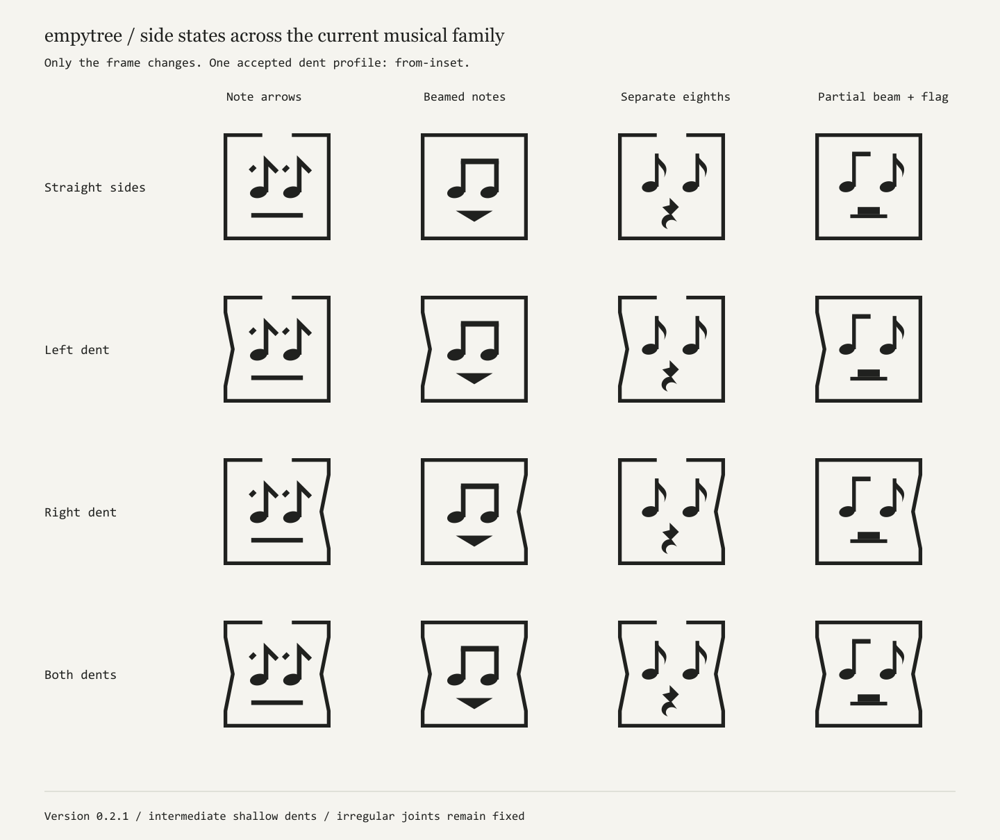

# empytree / personal mark system

[Русский](README.ru.md) · [Construction rules](docs/en/logo-system.md) · [Offline gallery](examples/index.html)

Quiet music from a crumpled box. A personal mark for **empytree**: note-like eyes also suggest upward arrows, a geometric mouth, and an open square with controlled side dents.



The accepted construction uses intermediate shallow dents (`from-inset`), the deliberately irregular notehead-to-stem joint (`character`), and a separate micro drawing with slightly smaller heads for 16 px. The canonical face has a straight mouth, open top and undented sides. Other side profiles and the smooth joint are historical studies.

The current website pool is **24 combinations**: six mouths × four side states, open frame. Optional closed frames bring the available first-version pool to 48. The full future musical matrix is planned, not implemented: 144 parameter combinations with one frame, 288 with open/closed frames, and 432 display combinations when the top-crease frame is included. These are not claims of distinct or readable 16 px silhouettes.

## Build and inspect

Use Node.js 24 and the committed lockfile:

```sh
npm ci
npm run build
npm run research:examples
npm run audit:docs
npm run check
```

Open [examples/index.html](examples/index.html) directly in a browser. It is self-contained and needs no API, server or ChatGPT host. Generated SVG, PNG and ICO assets are in `public/brand/v1/`. Node and Sharp are build dependencies; a consuming website needs only the exported static files and the selector script.

## Documentation

- [Construction and diversity — English](docs/en/logo-system.md), [Русский](docs/logo-system.md)
- [Build, algorithm and website adoption](docs/en/usage.md)
- [Authorship — English](AUTHORSHIP.en.md), [Русский](AUTHORSHIP.md)
- [Development decisions](docs/development-history.md), [rollout roadmap](docs/roadmap.md)
- [Future combination count](docs/variation-space.md)
- [Image analogy research and its limitations](docs/research/image-analogies.md)
- [Rights and publication research](docs/rights-and-publication.md)
- [Documentation audit](docs/documentation-audit.md)

Research and detailed historical records are currently in Russian; the English specification and authorship record cover the accepted state. Legal-policy drafts have not become an adopted bilingual license.

See the [language policy](docs/languages.md) and [initial commit plan](docs/commit-plan.md).

## Website consumer

This repository is separate from the website. The first adoption uses a pinned, versioned package of 24 static favicons; the browser chooses one per document load. It does not fetch executable code from GitHub at runtime. See the [adoption contract](docs/en/usage.md). Website adoption is still pending and will be recorded only after it happens.

## Rights

Concept, supplied sketch and art direction: **empytree**, [empytree.com](https://empytree.com/). Implementation was prepared with AI assistance under the author's direction. The [provenance record](AUTHORSHIP.en.md) distinguishes this from an authorship or trademark-registration guarantee.

The project is not currently declared open source. No blanket MIT or other reuse license has been selected. Public visibility and ordinary GitHub forks do not themselves grant a separate right to adopt this personal mark as another brand. The `private` package setting prevents accidental npm publication; it does not mean the GitHub repository must be private.
