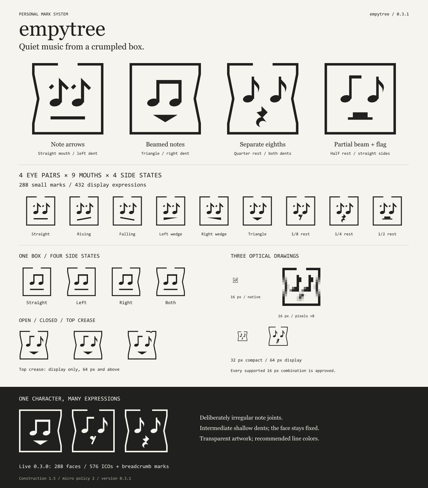

# empytree

[Русский](README.ru.md) · [Generator](examples/generator.html) · [Construction](docs/en/logo-system.md) · [Use on a website](docs/en/usage.md)

**Quiet music from a crumpled box.** A personal mark system by **Sergei Parfenov · empytree**. Note-like eyes, a changing mouth and a square with shallow dents keep one character across many expressions. The uneven notehead-to-stem joint is deliberate.

**Version 0.3.0 is deployed on [empytree.com](http://empytree.com/).** The site uses all **288** supported favicon combinations and independently selects a compact home-link mark in the jugbeat page's breadcrumbs. [Adoption and public verification](docs/adoptions/0.3.0.md).

**New revision 0.3.1:** transparent artwork, two recommended line colors, edge-to-edge geometry and ten resolutions per ICO. 288 expressions × 2 palettes = **576 ICOs**. 0.3.1 is not yet deployed. Default line colors may be overridden for a known placement. [Theme and density rules](docs/en/themes-and-density.md) · [Pixel comparison](docs/brand/themes-and-density.png).

## The system

| Part | Choices |
| --- | --- |
| Eyes | Note arrows; beamed notes; separate eighths; partial beam plus a flag |
| Mouth | Six lines/wedges/triangles, plus eighth, quarter and half rests |
| Sides | Straight, left dent, right dent, both dents |
| Frame | Open or closed; an additional top crease for display sizes |

Four eye pairs × nine mouths × four side states give **144** expressions per frame, **288** with open/closed frames and **432** in display with the top-crease frame. The author approves every supported 16 px combination. Optical measurements remain advisory and do not exclude faces. The generic selector defaults to 144 open-frame choices; the site explicitly enables both frames.

The canonical face is `arrows / flat / open / none`. Fixed features are the intermediate shallow dent profile, irregular joint and slightly reduced micro noteheads. There are three optical drawings: micro for 16–20 px, compact for 21–63, display from 64; favicon optics follow physical raster size. Formats and pixel densities do not multiply the face count.

## Explore and build

Open [the generator](examples/generator.html) directly in a browser: choose parts, inspect real 16 px rasters and download SVGs. It works offline. The [pixel sheet](docs/brand/pixel-check.png) compares twelve expressions at 1×/2×/3×; open the original image for native-pixel inspection.

Use Node.js 24:

```sh
npm ci
npm run verify
npm run generate -- --eyes mixed --mouth rest2 --dent left --size 128 --output .local/mark.svg
```

Current resources are in `public/brand/v2/`. `public/brand/v1/` and the [first-edition gallery](examples/index.html) preserve the earlier implementation. Website consumers receive a pinned static package; Node and Sharp are build tools, not server requirements. [Export and integration](docs/en/usage.md).

## Documentation

- [Line colors and transparency](docs/en/colors.md), [Русский](docs/colors.md)

- [Construction — English](docs/en/logo-system.md), [Русский](docs/logo-system.md)
- [Generator and author-approved micro policy — English](docs/en/generator.md), [Русский](docs/generator.md)
- [Website integration and breadcrumbs](docs/en/usage.md)
- [Current visual sheets and historical comparisons](docs/brand/README.md)
- [Combination counts](docs/variation-space.md), [development history](docs/development-history.md), [next steps](docs/roadmap.md)
- [Authorship — English](AUTHORSHIP.en.md), [Русский](AUTHORSHIP.md)
- [Image analogy research](docs/research/image-analogies.md), [rights/publication research](docs/rights-and-publication.md)

## Authorship and use

Concept, original sketch and art direction: **empytree**. Vector implementation, generation and documentation were prepared with AI assistance under the author's direction. [Provenance](AUTHORSHIP.en.md).

This is a personal identity, not an invitation to adopt the mark as another brand. No blanket reuse license has been selected; the project is not declared open source. Public visibility and ordinary GitHub forks do not themselves supply a separate brand-use license. [Rights and publication](docs/rights-and-publication.md).
