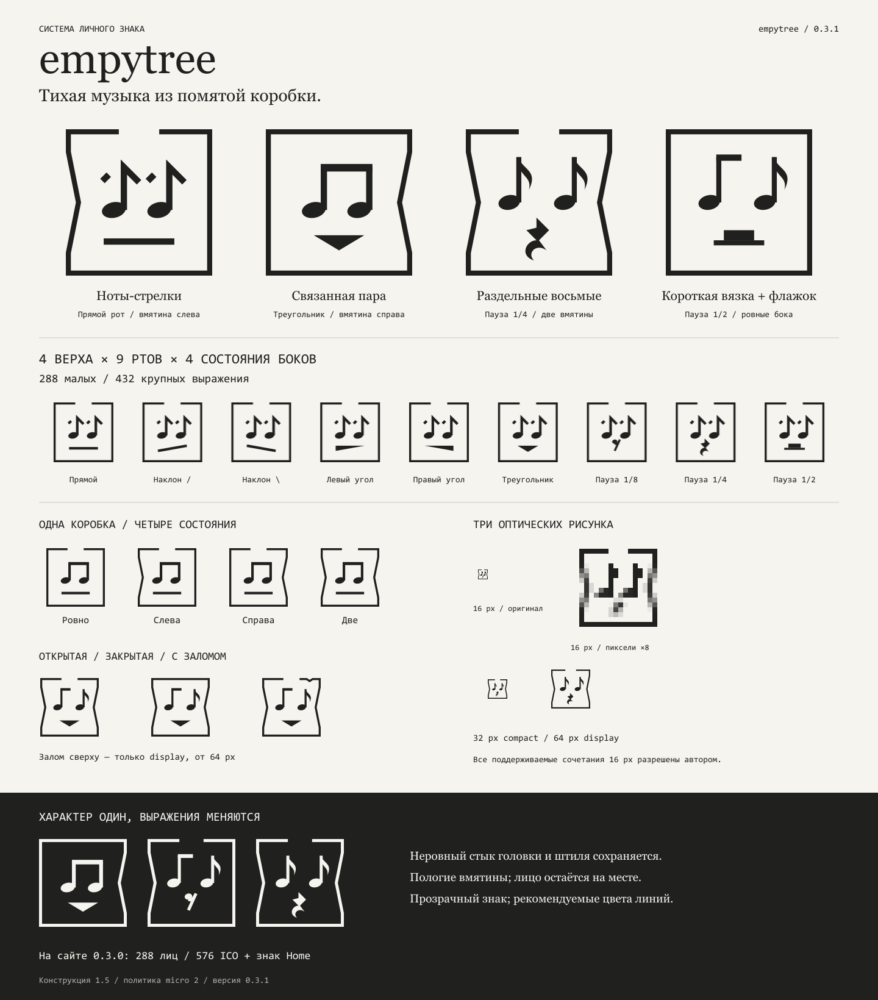

# empytree

[English](README.md) · [Генератор](examples/generator.html) · [Правила](docs/logo-system.md) · [Подключение к сайту](docs/en/usage.md)

**Тихая музыка из помятой коробки.** Система личного знака **Сергея Парфёнова · empytree**. Глаза-ноты, меняющийся рот и квадрат с пологими вмятинами сохраняют один характер при разных выражениях. Неровный стык головки и штиля намеренный.

**Версия 0.3.0 внедрена на [empytree.com](http://empytree.com/).** Сайт использует все **288** поддерживаемых вариантов favicon и независимо выбирает компактный знак ссылки на главную в хлебных крошках страницы jugbeat. [Запись внедрения и публичные проверки](docs/adoptions/0.3.0.md).

**Новая редакция 0.3.1:** прозрачные изображения, два рекомендуемых цвета линий, коробка до границ изображения и десять разрешений в каждом ICO. 288 выражений × 2 палитры = **576 ICO**. 0.3.1 ещё не внедрена. Цвет линий можно менять при известном фоне и творческой необходимости. [Правила темы и плотности](docs/themes-and-density.md) · [Сравнение пикселей](docs/brand/themes-and-density.png).

## Система

| Часть | Варианты |
| --- | --- |
| Глаза | Ноты-стрелки; связанная пара; раздельные восьмые; короткая вязка и флажок |
| Рот | Шесть черт/уголков/треугольников и паузы 1/8, 1/4, 1/2 |
| Бока | Ровные, вмятина слева, справа, с обеих сторон |
| Рамка | Открытая или закрытая; для крупного знака также залом сверху |

Четыре верха × девять ртов × четыре состояния боков дают **144** выражения при одной рамке, **288** с открытой/закрытой и **432** в display с заломом. Автор разрешил все поддерживаемые сочетания 16 px. Измерения остаются справочными и не запрещают варианты. Общий selector по умолчанию выбирает из 144 открытых; на сайте явно разрешены обе рамки.

Основной знак — `arrows / flat / open / none`. Неизменны пологий промежуточный профиль вмятины, неровный стык и чуть уменьшенные micro-головки. Три оптических рисунка: micro для 16–20 px, compact для 21–63, display от 64. Форматы и плотности экрана не увеличивают число выражений.

## Просмотр и сборка

[Генератор](examples/generator.html) открывается с диска без сети: выбор частей, реальные растры 16 px и скачивание SVG. [Лист пикселей](docs/brand/pixel-check.png) сравнивает двенадцать выражений при 1×/2×/3×; для проверки пикселей открыть исходное изображение без масштабирования.

Нужен Node.js 24:

```sh
npm ci
npm run verify
npm run generate -- --eyes mixed --mouth rest2 --dent left --size 128 --output .local/mark.svg
```

Текущие ресурсы — `public/brand/v2/`. `public/brand/v1/` и [первая галерея](examples/index.html) сохраняют предыдущую реализацию. Сайт получает зафиксированный статический пакет; Node и Sharp нужны для сборки, а не на сервере. [Экспорт и подключение](docs/en/usage.md).

## Документация

- [Цвет линий и прозрачность](docs/colors.md), [English](docs/en/colors.md)

- [Правила конструкции — русский](docs/logo-system.md), [English](docs/en/logo-system.md)
- [Генератор и утверждение всех micro — русский](docs/generator.md), [English](docs/en/generator.md)
- [Подключение и хлебные крошки](docs/en/usage.md)
- [Актуальные листы и исторические сравнения](docs/brand/README.md)
- [Число вариантов](docs/variation-space.md), [история решений](docs/development-history.md), [следующие шаги](docs/roadmap.md)
- [Авторство — русский](AUTHORSHIP.md), [English](AUTHORSHIP.en.md)
- [Исследование аналогий](docs/research/image-analogies.md), [публикация и права](docs/rights-and-publication.md)

## Авторство и использование

Концепция, исходный эскиз и художественное руководство — **empytree**. Векторная реализация, генератор и документация подготовлены с использованием ИИ по указаниям автора. [Происхождение](AUTHORSHIP.md).

Это персональный знак. Общая лицензия на повторное использование не выбрана; проект не объявляется open source. Публичность и обычные форки GitHub сами по себе не дают отдельного разрешения использовать знак как чужой бренд. [Публикация и права](docs/rights-and-publication.md).
