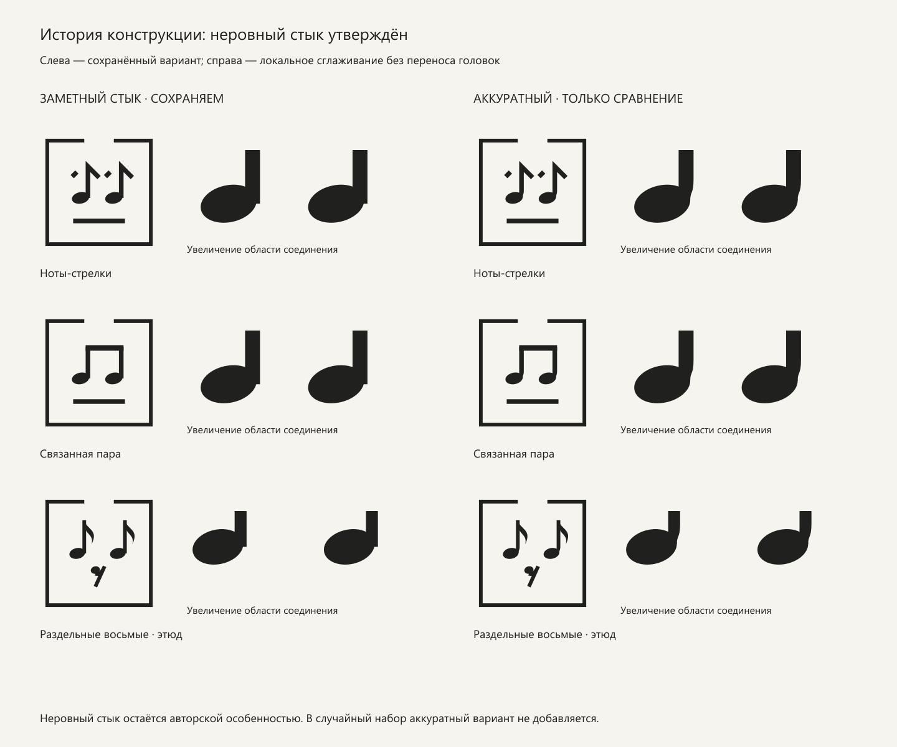
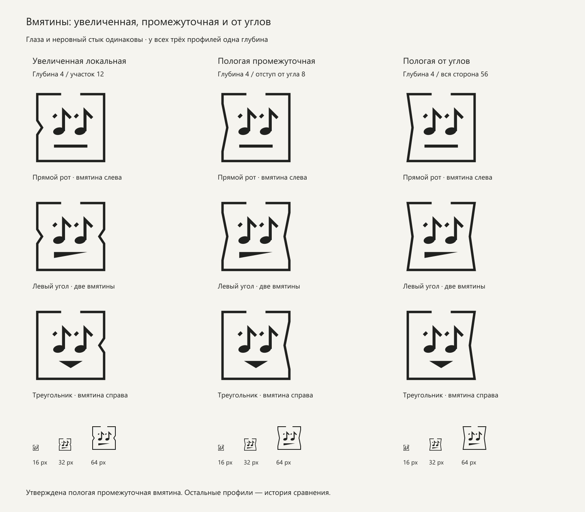
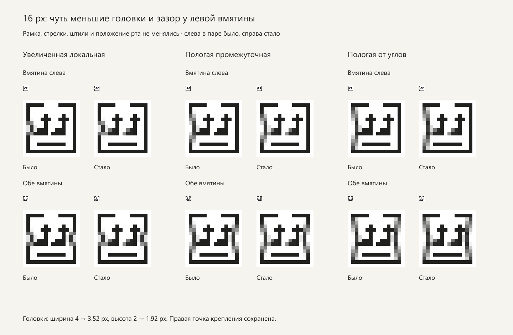
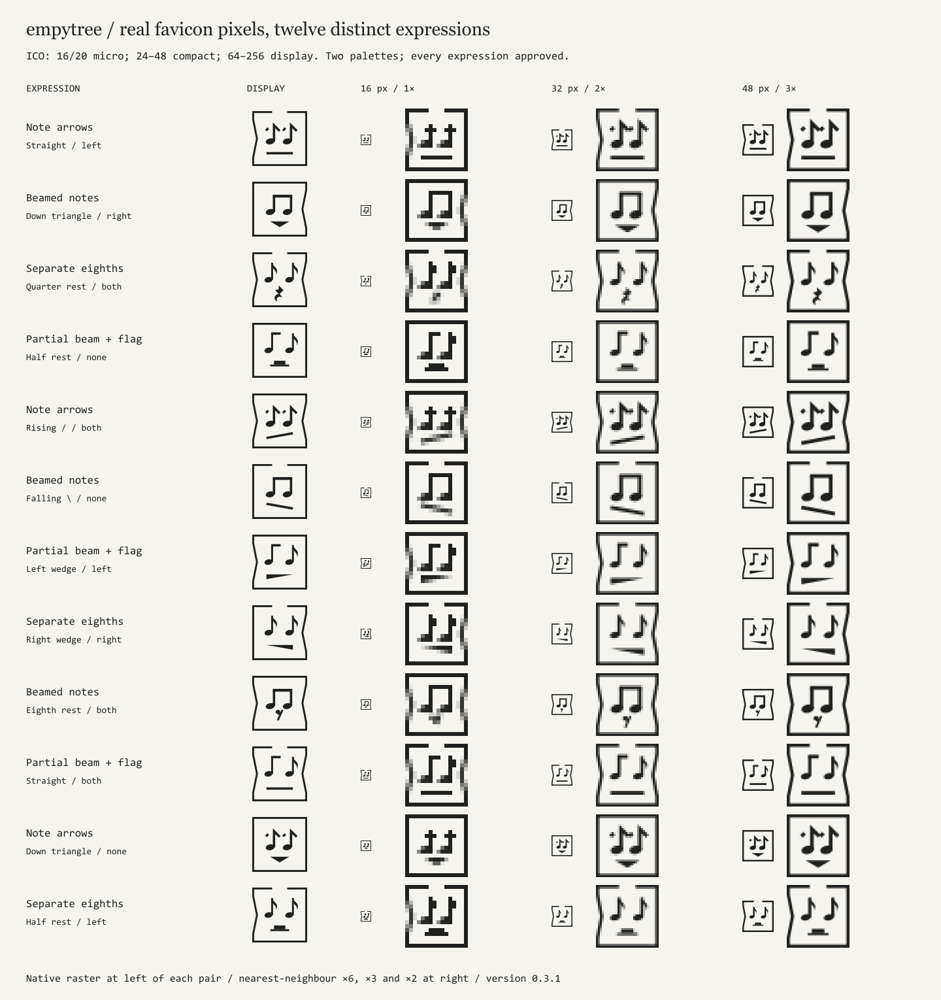

# empytree: тихая музыка из помятой коробки

[English specification](en/logo-system.md) · [План внедрения](roadmap.md)

Версия 1.3, 24 октября 2026. Статус: конструкция утверждена; первая версия 0.1.0 внедрена, следующий генератор 0.2.1 подготовлен к выпуску. Авторское обозначение — empytree. Приняты пологая промежуточная вмятина `from-inset`, неровный стык `character` и чуть уменьшенные головки micro. Первая реализация: шесть ртов и четыре состояния боков при постоянных глазах-стрелках. Другие профили в документационных сравнениях — история исследования, а не случайные рабочие состояния. Полная независимая музыкальная матрица реализована в [генераторе 0.2.1](generator.md); этот документ подробно описывает стабильную конструкцию и исторический API первой версии. Это описание персонального знака, не стандартной транспортной маркировки и не свидетельство регистрации товарного знака.


## Идея и характер

В квадрате живёт тихое лицо. Две наклонные головки нот становятся глазами; штиль и правый флажок напоминают восьмую ноту. Короткий штрих слева добавляет второе прочтение: две стрелки вверх. Спокойный рот одновременно напоминает основание транспортного знака «этой стороной вверх».

Рамка придаёт лицу форму коробки. Разрыв в середине верхней стороны допускает прочтение открытого верха. Небольшие угловые вмятины в середине боков добавляют образ помятой коробки. Это предложенная ассоциация: без контекста квадрат может восприниматься просто как рамка. Логотипу не обязательно буквально объяснять всю историю.

Характер личного бренда: сдержанный, музыкальный, немного неловкий и живой. Выражение меняется, личность сохраняется. Прямая линия служит спокойным опорным вариантом; наклоны и заполненные формы добавляют вариативность без превращения знака в набор разных персонажей. Фраза из брифа объясняет концепцию, но не является обязательной подписью или новым слоганом.

Для «помятой» коробки предусмотрены независимые небольшие вмятины слева и справа. Один залом сверху остаётся дополнительной крупной версией. Текстура картона, множество складок, лента, объём и тени в знак не входят: они отнимают место у лица.

## Неизменяемая часть

- Квадратный формат 1:1, без скругления углов.
- Две одинаковые головки, равная высота и постоянное расстояние между глазами.
- Вертикальные штиль-стрелки, направленные вверх.
- Один рот под глазами. Один цвет на всём знаке.
- Одинаковое положение углов и габариты рамки. Утверждённые наклоны начинаются после коротких прямых участков у углов и сходятся к середине боков.

Не поворачивать и не зеркалить весь знак: это меняет направление упаковочного символа. Не менять глаза, толщины и глубины вмятин произвольными случайными числами. Рот и состояние боков — независимые параметры конструкции; runtime выбирает готовое сочетание из их полного набора, с ограничением повторов внутри перемешанного цикла.

## Конструкция основного знака

Источник истины — `tools/identity-config.mjs` вместе с `tools/geometry.mjs`, а не округлённый PNG. Сетка основной версии — `64 × 64` единицы. Начало координат слева сверху; y растёт вниз. Координаты линий в таблице — осевые: острое miter-соединение флажка выступает за осевую вершину, это не координата внешнего контура.

| Элемент | Геометрия display |
| --- | --- |
| Рамка | Осевая линия от `(4,4)` до `(60,60)`, толщина `2` |
| Разрыв сверху | Между `x=24` и `x=40`, ширина `16` |
| Головки | Центры `(22,35)` и `(40,35)`, радиусы `4.75 × 3.1`, поворот `−12°` |
| Штили | `x=26` и `x=44`, от `y=18` до `y=35`, толщина `2.5` |
| Правый флажок | От `(x,18)` до `(x+6,24)`, толщина `2.5` |
| Левый штрих | От `(x−8.5,23.5)` до `(x−6,21)`, толщина `2.5` |
| Прямой рот | `x=18…46`, середина на `y=47.5`, толщина `2.5` |
| Общая форма рта | Поле `x=18…46`, `y=45…51` |

Головки намеренно немного смещают массу влево от штилей; лицо оценивается оптически, а не только по центру вертикальных линий. Соотношение рамки и содержимого сохраняет воздух, а содержимое чуть плотнее рамки. Окончания линий прямые; углы флажков острые. Шрифты и готовые наборы иконок не используются.

### Стык головки и штиля: конфликт как особенность

В текущей геометрии штиль и наклонная головка встречаются с небольшой видимой ступенькой: вертикаль заканчивается на уровне центра головки и немного выступает за её правый край. Это повторяется в нотах-стрелках, связанной паре и отдельных восьмых. По уточнению автора эта неидеальность теперь зафиксирована как намеренно сохраняемая особенность, а не дефект, который следует автоматически исправить.

Авторская трактовка: признание в неряшливости может работать красиво, как сдержанный протест против стерильной выверенности. Стык создаёт локальный конфликт между строгой рамкой, геометрической вертикалью и живой наклонной головкой. Предполагается, что он способен создавать напряжение и удерживать взгляд; это дизайнерская гипотеза, а не установленный эффект восприятия.

Ограничение важно: сохраняется одна конкретная воспроизводимая неровность. Случайные зазоры, утолщения, разъезды и новые артефакты не становятся допустимыми только потому, что знак допускает неидеальность. Стык не рандомизируется отдельно и не должен превращаться в разрыв между головкой и штилем. В micro эта особенность может быть неразличима; дорисовывать искусственный выступ ради 16 px не требуется.

Для сравнения подготовлен `joint='clean'`: нижний участок штиля плавно подводится к правой касательной наклонного эллипса. Положение и форма головок, оси штилей, флажки, рамка и рот сохраняются; меняется только место присоединения. Сравнение выполнено на нотах-стрелках, связанной паре и раздельных восьмых, с увеличением стыков. На увеличениях флажки и рот скрыты, чтобы они не попадали обрезками в область изучения; геометрия головок и примыкающих штилей та же. В 16 px варианты могут совпасть из-за квантования.



Окончательный выбор автора: `joint='character'`, неровный стык сохраняется. Аккуратные версии в `docs/brand/review/` и прежнее сравнение выше оставлены как история исследования; это больше не открытый выбор и не часть случайного набора фавиконов. Не «исправлять» стык при оптимизации SVG, объединении контуров, смене шрифта или переносе музыкальной ветки. После технических преобразований сравнивать силуэт с эталоном.

### Рамки

| ID | Правило | Применение |
| --- | --- | --- |
| `open` | Верхняя сторона разорвана по центру | Основной вариант, включая фавикон |
| `closed` | Непрерывная квадратная рамка | Допустимая более собранная версия |
| `crease` | Разрыв и один небольшой залом справа: `(47,4) → (50,6) → (53,4)` | Только display, от 64 px |

Залом — вариант для сравнения, а не обязательный знак коробки. Исторический API `mark()` переводит малый `crease` в `open`; новый `renderMark()` вместо подмены вызывает ошибку для compact/micro. В случайном наборе фавиконов по умолчанию используется только `open`. Для настройки можно разрешить `closed` вместе с ним.

### Помятые бока

Параметр `dent`: `none`, `left`, `right`, `both`. Левая и правая стороны независимы: это четыре сочетания двух переключателей. Каждая вмятина направлена внутрь, содержит один резкий угол на середине стороны и не сдвигает глаза, рот или углы коробки. Глубина и конструкция не выбираются случайно.

Принят профиль `from-inset`: глубина 4 единицы на сетке 64; возле верхнего и нижнего углов оставлены прямые участки по 8 единиц. Прежняя мелкая версия исключена. Таблица ниже задаёт утверждённую геометрию.

| Размер | Левая вмятина | Правая вмятина |
| --- | --- | --- |
| display, сетка 64 | `(4,12) → (8,32) → (4,52)` | `(60,12) → (56,32) → (60,52)` |
| compact, сетка 32 | `(1.75,5.75) → (3.75,16) → (1.75,26.25)` | `(30.25,5.75) → (28.25,16) → (30.25,26.25)` |
| micro, сетка 16 | `(1.5,3.5) → (2.75,8) → (1.5,12.5)` | `(14.5,3.5) → (13.25,8) → (14.5,12.5)` |

В micro глубина составляет 1.25 px; диагонали сглаживаются, а остальные участки рамки сплошные. Это оптическая адаптация, а не уменьшение координат display в четыре раза. При двух вмятинах появляется мягко суженный силуэт с острым переломом посередине; рамка не становится объёмной коробкой. Ровная рамка остаётся равноправным состоянием и статическим fallback.

#### Выбор одного профиля

В истории сравнения сохранены три конструкции `dentProfile`:

| ID | Сетка 64 | Статус |
| --- | --- | --- |
| `local-large` | Глубина 4, локальный участок `y=26…38` | Увеличенная локальная |
| `from-inset` | Прямая до `(4,12)`, наклон через `(8,32)` до `(4,52)`, прямая до нижнего угла; справа зеркально | Пологая промежуточная; утверждена, используется в экспортах |
| `from-corners` | От `(4,4)` через `(8,32)` к `(4,60)`; справа зеркально | Пологая от углов; историческое сравнение |

У всех трёх профилей одинаковая глубина: сравнивается протяжённость наклонов, а не одновременно другая глубина. На сетке 32 вершины находятся в `(3.75,16)` и `(28.25,16)`; на сетке 16 — `(2.75,8)` и `(13.25,8)`.

Промежуточный профиль оставляет короткие прямые участки возле углов: по 8 единиц на сетке 64, по 4 на сетке 32, по 2 на сетке 16. Поэтому наклон начинается на `y=12` и заканчивается на `y=52` в display, на `y=5.75…26.25` в compact и `y=3.5…12.5` в micro. В `from-corners` наклоны выходят непосредственно из верхнего и нижнего углов. Обе пологие версии меняют силуэт по большей части стороны, сохраняя острый перелом посередине.

Окончательный выбор автора — `from-inset`. Генератор сохраняет прочие профили только для воспроизводимости истории исследования; рабочие экспорты используют выбранный промежуточный профиль.



Профили не являются случайным параметром. `dentProfile='from-inset'` зафиксирован в `tools/identity-config.mjs`, и все рабочие файлы пересобираются с ним. Runtime выбирает рот, состояние боков и, если настроено, открытую/закрытую рамку. В manifest хранится одна политика `construction`; альтернативы — только в документационных сравнениях. Тот же файл фиксирует `joint='character'`.

## Шесть выражений

Названия описывают формы и не привязаны к сообщениям об ошибках, успехе или эмоциональному состоянию автора.

| ID | Форма display | Роль |
| --- | --- | --- |
| `flat` | Прямой горизонтальный прямоугольник | Основной знак, стабильный fallback |
| `rise` | Черта `(18,50) → (46,45)` | Наклон `/` |
| `fall` | Черта `(18,45) → (46,50)` | Наклон `\` |
| `corner-left` | Заполненный треугольник `(18,45), (46,45), (18,50)` | Масса слева |
| `corner-right` | Заполненный треугольник `(18,45), (46,45), (46,50)` | Масса справа |
| `down` | Треугольник `(22,45), (42,45), (32,51)` | Вершина вниз |

При смене рта голова не подпрыгивает, глаза не перемещаются, габарит изображения не меняется. Заполненные рты не растут до ширины рамки. У favicon нет плавного морфинга и анимации.

## Музыкальное прочтение и компромисс

Нельзя утверждать, что две соседние восьмые всегда обязаны иметь общую вязку только из-за расстояния между ними. Группировка зависит от метра, долей, жанра, текста и редакционной практики; пауза тоже не исключает объединение. Здесь нет стана, размера и заданного музыкального времени, поэтому знак не является однозначно исполнимой записью.

Основное семейство `arrows` сознательно использует гибридный графический символ: его прямой флажок и отдельный левый штрих не выдают себя за академически точную гравировку. Это сильнее сохраняет исходную идею «музыка + этой стороной вверх». В документации и подписи его корректно называть «ноты-стрелки».

Подготовлены три самостоятельных этюда, все от 64 px:

- `study-beam.svg`: две головки с общей вязкой. Музыкальная пара считывается прямее, но две отдельные стрелки исчезают. Это альтернативная ветка, а не случайное состояние основного фавикона.
- `study-rest8.svg`: настоящие по характеру восьмые флажки и геометрически упрощённая восьмая пауза как рот. Пауза переходит ниже воображаемой линии нот ради лица; порядок событий остаётся ассоциацией.
- `study-rest4.svg`: такие же глаза и четвертная пауза внизу. Рот выразительнее, но в малом размере теряется и перегружает знак.

Паузы нарисованы заново и стилизованы. Не называть эти композиции корректной партитурой: для этого нужно отдельно задать музыкальный фрагмент и выгравировать его со станом. В малый случайный набор они не входят. Транспортный образ из референса использован как идея; стоковое изображение, его рамка и водяной знак в исходники не переносились.

### Следующий генератор: независимые музыкальные части

Это развитие первой реализации, выполненное в кандидате 0.2.1. Вместо привязанных этюдов новый API использует независимые параметры `eyes` и `mouth`:

- Верх: исходные ноты-стрелки; две ноты с общей вязкой; две раздельные восьмые; вариант из нового референса — левая нота с короткой горизонтальной вязкой, правая с отдельным флажком. Здесь короткая вязка не соединяет глаза; её не следует ошибочно описывать как ещё одну связанную пару.
- Низ: шесть исходных черт и треугольников; восьмая, четвертная и половинная паузы. Для половинной паузы сохранить короткую опорную линию: прямоугольник стоит над ней, в отличие от целой паузы, которая висит под линией.
- Бока: уже реализованные четыре состояния `dent` переиспользуются без изменения.

Генерация из независимых частей, половинная пауза и четвёртый верх реализованы. Для малых размеров выполнены измерения масок слоёв при 1×/2×/3×. Автор разрешил все 288 открытых/закрытых сочетаний, 144 открытых по умолчанию; измерения остаются справочными. Не принимать наличие крупного SVG за разрешение использовать его в 16 px; полный отчёт и решение автора находятся в [правилах генератора](generator.md).

Реализованная матрица: 4 верха × 9 ртов × 4 состояния боков = **144** сочетания при одной рамке; с открытой/закрытой рамкой — **288**, с дополнительной рамкой с заломом — **432** для display. Это комбинации параметров, не доказательство различимости растров 16 px. Подробности и воспроизводимый расчёт — [число вариантов](variation-space.md).

## Оптические размеры

SVG масштабируется без потери геометрической точности, но узнаваемость не бывает одинаковой при любом числе пикселей. Минимальная рабочая цель этой системы — 16 CSS px. Значения меньше 16 px не обещаются как читаемый логотип.

| Версия | Рабочий размер | Что меняется |
| --- | --- | --- |
| `display` | От 64 CSS px | Раздельный левый штрих, наклонные эллипсы, тонкая рамка `2/64` |
| `compact` | 24–63 CSS px | Сетка `32`, рамка `1.5`, штиль и рот `1.75`, головки `3 × 2`; масса относительно размера увеличена |
| `micro` | 16–20 CSS px, в первую очередь вкладка браузера | Сетка `16`, рамка и штиль по 1 px, головки построены пиксельным силуэтом; левый штрих соединён с вершиной стрелки |

Для промежутка 21–23 px использовать compact. Масштабировать пропорционально; по возможности выбирать стандартные размеры 16, 24, 32, 48, 64, 96. В micro прямой рот занимает ровно строку `y=12`, `x=4…11`: полупиксельное положение даёт две серые строки и убирает нужную массу. Другие рты допускают сглаживание диагоналей.

### Чуть меньшие головки в 16 px

Для micro ширина головки уменьшена с 4 до 3.52 px, высота — с 2 до 1.92 px. Масштабирование `0.88 × 0.96` выполняется только для головки относительно точки крепления `(7,9)` внутри каждой ноты; вторая нота сдвинута на 5 px. Правый край головки остаётся на `x=7`, а левый край отступает внутрь на 0.48 px. Это освобождает пространство у левой вмятины. Толщина и оси штилей, стрелки, рот и рамка не меняются.

Уменьшение одинаково для ровных и помятых micro-знаков, чтобы размер глаз не прыгал при смене состояния коробки. В compact и display головки остаются прежними. Это локальная оптическая поправка, а не изменение утверждённого характера стыка. Та же micro-геометрия используется во всех слоях ICO для плотностей экрана 1×, 2× и 3×.



Важное различие: PNG `*-32.png` показывает compact в размере 32 px, а слой 32 px внутри ICO показывает micro для вкладки 16 CSS px на экране 2×. Все три слоя ICO — одна версия micro в плотностях 1×, 2× и 3×. Это сохраняет выражение и массу между экранами. SVG `*-adaptive.svg` также использует micro и переключает цвет по теме браузера; его можно выбрать вместо ICO отдельной интеграцией.



## Цвет, фон и свободное поле

Основной знак одноцветный. Цвет не кодирует выражение. Исходные `mark-*.svg` используют `currentColor`: при вставке SVG в HTML знак наследует цвет. При использовании через `` родительский CSS `color` внутрь файла не передаётся; для тёмного фона применять `logo-reverse.svg` или готовить файл с явным цветом.

Рабочая пара примеров: тёмный `#20211f` на белом и светлый `#f5f4ef` на тёмном. Это проверочная палитра, а не обязательные цвета личного бренда. Поддерживать заметный контраст со всем фоном; ориентир для малых знаков — хотя бы 3:1, предпочтительно выше. Если знак служит ссылкой, доступное имя даёт имя автора или «На главную», а не описание формы глаз.

ICO и обычные PNG имеют непрозрачный белый фон, поэтому тёмный знак сохраняет читаемость на светлой и тёмной панели браузера. Это стабильный компромисс. Небольшая белая подложка является частью экспорта favicon, но не частью прозрачного мастер-знака. PNG `*-dark.png` — готовая обратная версия 16/32/48 px с тёмной подложкой. Файлы `*-adaptive.svg` прозрачны и меняют цвет; их обработка темы и выбор браузером требуют проверки в целевых браузерах.

Вокруг крупного знака оставлять минимум `8/64` его стороны с каждой стороны, сверх внутреннего отступа. При размещении вплотную к соседнему тексту лучше увеличить это поле. В системной ячейке favicon дополнительное внешнее поле не добавлять: оно уже учтено сеткой. Не помещать знак на пёстрый фон без спокойной контрастной подложки.

## Случайный выбор фавикона первой версии

Ниже описан исторический API `public/brand/v1`. На сайте версия 0.1.0 использует путь `/brand/empytree/v0.1.0/`, а не исходный `/brand/v1/`. Следующий selector и отбор micro описаны в [правилах генератора 0.2.1](generator.md).

`public/brand/v1/random-favicon.js` готов для подключения. Он не зависит от фреймворка и выбирает одну из 24 комбинаций при загрузке документа: 6 ртов × 4 состояния боков, с открытой рамкой. В рамках вкладки хранится перемешанный мешок сочетаний в `sessionStorage`: каждое показывается один раз за цикл; соседние циклы не дают немедленного повтора полного сочетания. Один и тот же рот может повториться с другой вмятиной. Порядок блоков сайта может оставаться независимым: их связывает принцип вариативности, а не один общий случайный индекс.

Нет таймера, фоновых переключений, изменения заголовка вкладки или сетевого запроса к API. Браузер загружает выбранный статический файл. При заблокированном хранилище выбор остаётся случайным, но гарантия отсутствия повторов между загрузками пропадает. При отключённом JavaScript остаётся основной `favicon.ico`. В новой вкладке начинается собственная последовательность; браузер может скопировать начальное `sessionStorage` при дублировании вкладки.

Фрагмент подключения лежит в `docs/favicon-head.html`:

```html
<link rel="icon" type="image/x-icon" sizes="16x16 32x32 48x48"
      href="/brand/v1/favicon.ico" data-empytree-favicon>
<link rel="apple-touch-icon" sizes="180x180"
      href="/brand/v1/apple-touch-icon.png">
<script defer src="/brand/v1/random-favicon.js"></script>
```

Заменить временный `<link rel="icon" href="data:,">`, удалить конкурирующие `rel="icon"` и вставить фрагмент во все независимые HTML-head. Основной общий head и самостоятельные исторические страницы нужно обработать отдельно; кодировку Windows-1251 не перекодировать попутно. Страница, которая строит head через PHP, должна выводить эти теги в своём документе. При размещении сайта в подкаталоге скорректировать начальные пути; сам скрипт разрешает URL вариантов относительно своего `src`.

Настройки задаются на подключении скрипта:

```html
<!-- Только три линейных рта; обе рамки; вмятина либо отсутствует, либо слева. -->
<script defer src="/brand/v1/random-favicon.js"
        data-mouths="flat,rise,fall" data-frames="open,closed"
        data-dents="none,left"></script>
```

Набор по умолчанию — все шесть ртов, все четыре состояния боков и только `open`: 24 сочетания. При включении обеих рамок доступны 48. `data-dents="none"` оставляет только ровные бока. `data-enabled="false"` оставляет статический основной знак. `crease`, произвольные пути и музыкальные этюды в настройках не разрешаются. Не подключать второй экземпляр скрипта к одному документу. Набор зафиксирован в `variants.json`; runtime не загружает JSON.

### Поиск, кэш и системные иконки

Адрес базового favicon стабилен: `/brand/v1/favicon.ico`, слои 16/32/48. В исходном head указан он. PNG `/brand/v1/favicon-96.png` тоже подготовлен, но текущий фрагмент head его не подключает; наличие файла само по себе не означает его использование поисковиком. Google рекомендует стабильный URL и использует один favicon на hostname; минимум — 8 × 8, рекомендован размер больше 48 × 48. Текущий ICO соответствует минимальному требованию, но не рекомендации о размере больше 48. При выборе статической поисковой стратегии можно явно указать PNG 96. Не выдавать устаревшее «только кратно 48» за требование.

Вкладка может менять выражение через JavaScript. Нельзя гарантировать, какое выражение выберет поисковик, учитывающий отрендеренную страницу: отдельного надёжного `rel` только для поискового favicon нет. Если нужна строго фиксированная иконка в поиске, следует выбрать статическую стратегию вместо случайной на главной странице. Появление и обновление favicon в выдаче не гарантируются.

Apple touch icon остаётся постоянным. Android/PWA manifest не добавлен: наличие favicon само по себе не делает сайт устанавливаемым приложением. Для будущего manifest есть квадратные PNG 192 и 512 px; `purpose: maskable` не заявляется без отдельной проверки безопасной области.

Не обходить кэш случайными query-параметрами на каждой загрузке. У каждого варианта свой стабильный URL; менять `/v1/` на следующую версию при несовместимом обновлении геометрии. Статические файлы можно кэшировать надолго только при соблюдении такого версионирования. Самостоятельный JS не требует inline-скриптов и совместим с CSP `script-src 'self'`; дополнительных разрешений для API нет.

## Файлы и воспроизводимость

Это автономный комплект для репозитория. Владелец опубликовал исходную систему и внедрил 0.1.0; [запись внедрения](adoptions/0.1.0.md) содержит публичные подтверждения. Кандидат 0.2.1 ещё не внедрён. Пути конкретной локальной среды не являются частью правил бренда. Коммиты, push и выкладку выполняет владелец. Готовые ресурсы не требуют Node на сервере.

Переносить по назначению:

- `docs/logo-system.md`, `docs/favicon-head.html`, `docs/brand/*` — документация и листы сравнения.
- `public/brand/v1/*` — готовые SVG, PNG, ICO, список вариантов и скрипт выбора.
- `tools/identity-config.mjs`, `tools/geometry.mjs`, `tools/build.mjs`, `tools/comparisons.mjs`, `tools/check.test.mjs` — единая политика, генератор, сравнения и проверка; это инструменты разработки, не runtime сайта.
- Отдельный `package.json` нужен только для пересборки графики. В PHP-проекте без Node его можно хранить в `tools/logo-system/`, скорректировав относительные пути генератора. Готовые ресурсы не требуют Node на сервере.

Воспроизводимая сборка: Node.js 24, `npm ci`, `npm run verify`. Зависимость Sharp зафиксирована lock-файлом. При использовании заранее установленного Sharp можно задать `EMPYTREE_SHARP` абсолютным путём к пакету.

Пользоваться генератором, а не вручную редактировать десятки экспортов. Исторический build.mjs создаёт 6 ртов × 2 малых рамки × 4 состояния боков = 48 наборов, 3 оптические версии, дополнительные display-знаки с заломом и 3 музыкальных этюда. PNG ровных вариантов доступны в 16/32/48/64/96/192/512, помятых — в 16/32/48/96; все комбинации имеют ICO 16/32/48 и адаптивный SVG. Остальные размеры получают из SVG. Обратные PNG включены для 16/32/48. Растеризация начинается сразу в нужном разрешении, включая ICO для 2× и 3×. Перегенерация не удаляет посторонние файлы. Внешних шрифтов, стоковых иконок и сетевых ресурсов у знаков нет. Новый build-system.mjs добавляет 1008 оптических SVG, PNG micro-кандидатов и ICO только разрешённых сочетаний; правила и CLI описаны в [генераторе](generator.md).

Для следующего внедрения используется `npm run export:site -- --commit FULL_SHA` из чистого checkout с реальным commit: пакет 0.2.1 содержит 288 ICO, 288 компактных SVG и 144 открытых варианта по умолчанию. `public/brand/v1` сохраняет каталог первой версии; `public/brand/v2` — новую матрицу и allowlist. Исторический ограниченный экспорт 24 сочетаний доступен как `export:legacy`. Каждый потребитель получает версионный путь и `logo-source.json`. Инструкции — [building and adoption](en/usage.md) и [новый генератор](generator.md). Разработческий `--development` пакет не считается выпущенной версией.

## Приёмка

Автоматическая проверка охватывает отсутствие повторов за цикл из 24 сочетаний, границы циклов, изменённый набор, отказ/повреждение хранилища, fallback без подходящего link, размеры и непрозрачность всех слоёв 48 ICO, наличие всех ресурсов в manifest, различие шести растров 16 px и сплошную пиксельную строку прямого рта, в том числе рамку в 2×. Визуально проверены общий лист, увеличенные пиксели, 24 комбинации помятых боков и обратные варианты. Интерактивный просмотр рядом с чатом позволяет сравнить формы; это не проверка favicon в браузерной панели.

Дополнительные проверки контролируют утверждённый промежуточный профиль, сохранность исходных крупных SVG с заметными стыками по SHA-256, неизменность головок и верхней части нот у аккуратного исторического этюда, а также неизменность лица между тремя профилями вмятин. Проверены исключение мелкого профиля и увеличение светлого зазора у левой micro-вмятины при сохранении штилей и тёмного ядра головки. Стык и профиль вмятины нельзя случайно перемешать между экспортами одной версии.

Перед рабочим подключением проверить реальную вкладку 16 CSS px на 1× и 2× в целевых браузерах, тёмную/светлую панель, отсутствие старого конкурирующего link, no-JS и исторические кодировки. До этого готовность графики и компонента не следует называть проверенной production-интеграцией.

После выбора концепции полезна короткая проверка с несколькими людьми: сначала показать 16 px без пояснения и попросить назвать увиденное; затем 64 px и краткую историю. Критерий — устойчивое узнавание одного лица и музыкального мотива, а не обязательное угадывание всей фразы. Не утверждать уникальность на рынке или юридическую охраноспособность без отдельного поиска.

## Использованные практики и источники

Мастер построен векторно; растры получаются из него детерминированно. Для сравнения применялись интерактивные представления и реальные растры 16/32/48 px. Исходный эскиз и творческие решения принадлежат empytree; подготовка векторного кода и документации выполнялась с использованием ИИ по его указаниям. Подробнее — [происхождение разработки](../AUTHORSHIP.md).

- [Google Design — Evolving the Google Identity](https://design.google/library/evolving-google-identity): оптическое усиление малого знака, система постоянных признаков и вариантов, канонические исходники. Использованы как метод, формы Google не заимствованы.
- [Google Search Central — Define a favicon to show in search results](https://developers.google.com/search/docs/appearance/favicon-in-search): квадрат, стабильный адрес, размеры и ограничения поискового показа. Проверено 24.10.2026.
- [W3C MusicXML 4.0 — beam](https://www.w3.org/2021/06/musicxml40/musicxml-reference/elements/beam/): различие флажков и соединяющей вязки. Эта техническая спецификация не устанавливает универсальное правило «любые две восьмые обязательно объединять».
- [Music Encoding Initiative — Common Music Notation](https://music-encoding.org/guidelines/dev/mei-cmn/content/cmn.html): модель группировки нот и пауз; источник о структуре нотации, а не доказательство музыкальной корректности логотипа.

Исходные эскизы и предоставленные референсы использованы как материалы брифа. Рабочие линии построены заново. Найденные в интернете чужие логотипы не включены в ресурсы системы. [Исследование аналогий](research/image-analogies.md) и [публикация и права](rights-and-publication.md) вынесены в отдельные документы; они не доказывают уникальность или охраноспособность.
