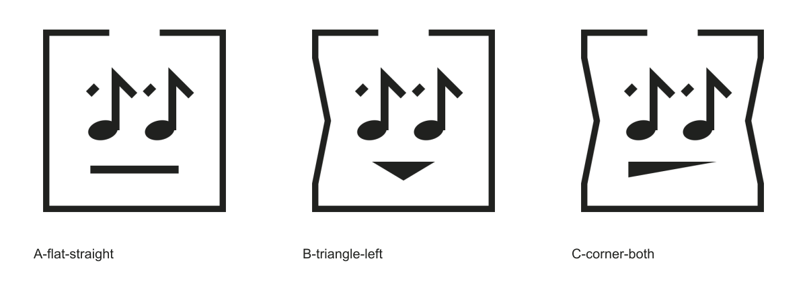

# Исследование визуальных аналогий

Дата: 24 октября 2026. Объект — утверждённая система empytree с промежуточной пологой вмятиной и неровным стыком.

## Что и как проверялось

Подготовлены три собственных образца 512 × 512 с заметной разницей в силуэте и выражении:

| Образец | Содержание |
| --- | --- |
| [A-flat-straight](examples/A-flat-straight.png) | Прямой рот, ровные бока |
| [B-triangle-left](examples/B-triangle-left.png) | Рот вершиной вниз, вмятина слева |
| [C-corner-both](examples/C-corner-both.png) | Заполненный левый угол рта, обе вмятины |

Параметры и SHA-256 собственных файлов — [manifest.json](examples/manifest.json). Они воспроизводятся `node tools/research-examples.mjs` и не являются чужими изображениями.

Выполнен поиск **изображений по текстовым визуальным признакам**, соотнесённым с этими образцами. Запросы:

- `music note eyes face logo square`
- `music notes face box logo`
- `this side up arrows face logo`
- `"music" "note" "face" "square" logo`
- `"music" "face" "triangle" logo`
- `"music notes" "face" "box" logo`

Это не загрузочный обратный поиск по самим PNG: автоматизация Chrome остановилась из-за невозможности надёжно определить адрес страницы для проверки правил доступа. Поэтому Google Lens, Яндекс Картинки и TinEye с загрузкой A/B/C в этом исследовании **не проверены**. Нельзя представлять текстовый поиск картинок как их полный эквивалент.

Из выдачи выбраны кандидаты; проверены страницы первоисточников. Изображения Upbeat, Just Looking и Mood Music отдельно просмотрены для сравнения. Прозрачные изображения первых двух для внутреннего просмотра показаны на белом фоне; чужие файлы не включены в этот репозиторный комплект. Копирование их в свои ресурсы или вывод о свободной лицензии не производились.

## Найденные аналогии

### Mood Music — Hunter Ellenbarger

На [авторской странице Dribbble](https://dribbble.com/shots/3442694-mood-music) работа описана как концепт для приложения. Видны две связанные ноты-глаза с белыми зрачками и дуга улыбки. Это близкая аналогия общей идеи «музыкальная пара как лицо», особенно для будущей ветки связанных нот. Отличия empytree: стрелочные вершины, раздельные короткие штрихи, заполненные наклонные головки без зрачков, самостоятельные геометрические рты и квадратная коробка с разрывом и вмятинами. Конкретные рисунки различаются.

### Upbeat Music, Inc.

На [странице компании в Gust](https://gust.com/companies/upbeatmusic) размещён музыкальный персонаж: головки нот с белыми бликами/зрачками, улыбка и крупная волнистая перемычка, напоминающая волосы. Общий приём нот-глаз уже применяется в музыкальной идентичности. В отличие от empytree здесь нет коробки, прямых стрелочных верхушек, угловых вмятин и спокойной прямой черты рта. Дату создания самого рисунка по имени файла или дате основания компании не устанавливаем.

### Just Looking Productions

На [сайте агентства](https://www.justlookingproductions.com/) используется круглая композиция с двумя нотами и зрачками. Штили наклонены, флажки плавные, нотные головки воспринимаются как глаза; круг формирует голову. Отдельного прямого рта, квадратной упаковочной рамки и стрелочного прочтения как в empytree нет. Это аналогия сочетания «две ноты + лицо + контейнер», а не точное совпадение геометрии.

### Упаковочные пиктограммы и «music box»

Поиск возвращает обычные [две стрелки вверх с основанием](https://icons8.com/icon/13130/this-way-up) и множество буквальных [коробок с музыкальными нотами](https://www.creativefabrica.com/product/music-box-app-logo-design/). Это ожидаемые составляющие исходной метафоры. Их наличие не доказывает заимствование, но показывает, что идея упаковочного знака и сочетание музыки с коробкой сами по себе не уникальны.

## Вывод для этой системы

В просмотренной выборке точного совпадения с конструкцией empytree не обнаружено. Это ограниченный результат конкретного поиска, а не подтверждение отсутствия совпадений в интернете или реестрах. Общая идея музыкального лица существует; индивидуальность здесь сосредоточена в конкретном сочетании нот-стрелок, характерного стыка, выражений и открытой коробки с пологими боками.

Изменение только рта не устраняет сходство общей композиции. Для будущей связанной музыкальной пары особенно полезно сохранять остальные собственные признаки системы и вновь проверять итоговый рисунок.

## Что остаётся за пределами исследования

Не проверены статусы прав на найденные логотипы, владельцы зарегистрированных знаков, классы товаров/услуг, территории и вероятность смешения. Не проводился поиск доступности самого слова `empytree` и вариантов его написания.

Для юридической проверки нужны реестры по целевым рынкам, включая Роспатент, WIPO, EUIPO и USPTO, поиск обозначения и изображений, оценка перечней товаров/услуг. [WIPO Global Brand Database](https://www.wipo.int/en/web/global-brand-database) поддерживает сходство изображений, но сама WIPO рекомендует также национальные и региональные реестры. Это отдельный этап; здесь он не объявляется выполненным.

Обратный поиск A/B/C с загрузкой, когда доступен управляемый браузер, стоит провести дополнительно и сохранить дату, поисковик, входной файл и ссылки на кандидатов. Результат «совпадений не найдено» сам по себе не означает охраноспособность.
